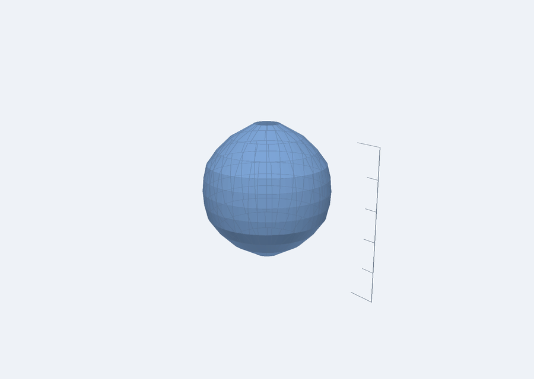
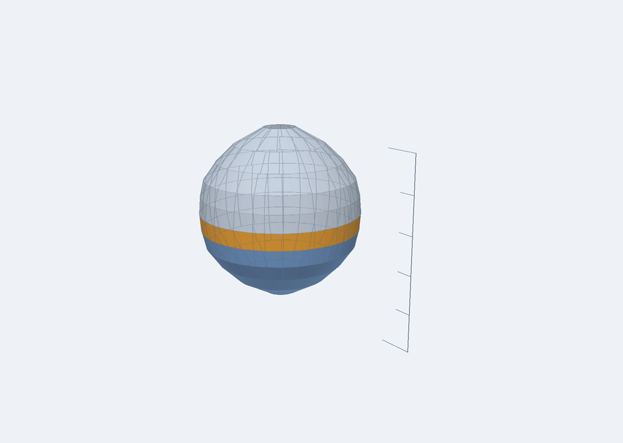

# 玩偶图解工作台 · Amigurumi Studio

把「想要的形状」变成「能照着钩的图解」，并且**在钩之前先在三维里看见它**。

## 为什么做这个

钩针玩偶的底层是一套很硬的逻辑，三步就能写清楚：

```
第 n 圈针数：  cₙ = cₙ₋₁ + incₙ − decₙ
该圈周长：     Pₙ = cₙ · w          （w = 针宽）
该圈半径：     rₙ = cₙ · w / 2π
该圈高度：     hₙ = n · h          （h = 针高）
```

**加针率就是曲率**：每圈正好加 6 针（短针）走平面，加得少就往上鼓成球，加得多就往外张成马鞍。
所以「设计玩偶」= 设计一条**针数曲线**，图解只是把这条曲线记录下来。

但公式只在「计数与拓扑」这一层成立，有三件事必须承认：
1. `w`、`h` 取决于线材 + 钩针 + 手劲，是**参数**不是常数；
2. 塞棉量和线的弹性会影响最终形状；
3. 整数化 + 可钩性约束会修改序列，所以**成品必然偏离目标轮廓** —— 本项目把这个偏差量化出来给你看，而不是假装公式是精确的。

## 核心主张

> 图解不是唯一解，是一个**解族**。
> 所以我们不追求「生成标准答案」，只追求「**合法**且**拟合目标**」。

- **合法** = 每一圈消耗的针目数严格等于上一圈的针目数（耦合守恒）
- **拟合** = 针数曲线对应的轮廓尽量贴近你给的剖面

## 三维可视化（核心）

三维视图不是"把形状画出来"那么简单，它必须**能用来核对图解**：

- **曲面上的每一格 = 图解里的一针**。横向格子数就是该圈针数，可以**直接数针**核对。
- 纵向网格线的角度**不是平均分配的**，而是取自 [`src/chart.js`](src/chart.js) 的拓扑定位 ——
  也就是"这一针真正穿在上一圈哪一针上"。所以三维网格与符号图解、文字图解**用的是同一份角度数据**。
- **逐圈高亮**：拖「当前第 N 圈」，已钩变蓝、当前圈琥珀、未钩半透明。钩到第 20 圈就拖到 20，逐圈对照。
- **标尺**：每格 10mm、长格 50mm，用来读成品尺寸。
- 改剖面或拖 `w`/`h`（gauge），实体、网格、图解、侧视对照图**同时**重算。

## 原生渲染窗口（完全绕开浏览器）

浏览器会碰到 WebGL 被禁用、CDN 被墙、缓存过期这些问题。所以另有一条**不经过浏览器**的路径：

```bash
python tools/viewer.py        # 直接开窗口（推荐）
```

窗口里三个页签：**三维预览**（拖动旋转 / 滚轮缩放 / 逐圈高亮）、**符号图解**、**文字图解**。
流程是：写一句提示词 → 点「解析提示词」→ 尺寸框回填 → 看三维和图解；
也可以直接改「形状 / 直径 / 高 / 针宽 / 针高」再点「确定生成」。

也可以命令行单独出图：

```bash
node tools/emit-scene.mjs '{"prompt":"直径6cm的球","gauge":{"w":5,"h":5}}' tools/scene.json
python tools/render.py tools/scene.json solid.png            # 三维
python tools/render.py tools/scene.json chart.png --chart     # 符号图解
```

**提示词 → 形状**用的是规则解析（[`src/prompt.js`](src/prompt.js)）：确定性、不联网、不需要密钥。

| 你说 | 它理解成 |
|---|---|
| 直径6cm的圆球 | 球 · 直径 60mm（高按形状惯例推为 60mm） |
| 高8cm的水滴形，下面胖一点 | 水滴 · 高 80mm · 最粗处下移到 34% 高度 |
| 头围30cm的圆头 | 围度 ÷ π → 直径 95mm |
| 细长的手臂，长10cm，粗2cm | Ø20mm × 高100mm（**写明尺寸后形容词不再叠乘**） |

每条推断都会显示在窗口底部——**你必须能看到"系统把你的话理解成了什么"**，否则改错了也不知道为什么。





- 渲染是**软件光栅化**（画家算法 + 平面着色 + 2 倍超采样抗锯齿）：不用 OpenGL、不用 three.js、不联网。
- **几何只有一份**：`src/solid.js`。网页版和原生窗口用的是同一份数据，不可能漂移。
- 附带好处：渲染结果能直接存成 PNG，所以**效果可以在没有浏览器的情况下被检查** ——
  这也是我能自己验证"三维到底画出来没有"的方式。

## 已实现

| 模块 | 作用 |
|---|---|
| [`src/ir.js`](src/ir.js) | 数据模型 —— 全系统唯一真源，图解与预览都必须由它派生 |
| [`src/build.js`](src/build.js) | 剖面曲线 → 针数序列（整数化 + 加减针均匀分布 + 耦合夹紧 + 偏差量化） |
| [`src/validate.js`](src/validate.js) | 合法性校验：耦合守恒、单圈变化上限、收口、分布均匀性（12 条规则） |
| [`src/pattern.js`](src/pattern.js) | 针数序列 → 文字图解（`6X` / `(X,V)×6` 那套语法） |
| [`src/chart.js`](src/chart.js) | IR → **环形符号图解** SVG：每一针按它真正穿的那一针定位 |
| [`src/shape.js`](src/shape.js) | 形状规格（直径/高/最粗处/收口）→ 剖面曲线；**强制采到最粗处**，保证峰值针数兑现设定尺寸 |
| [`src/prompt.js`](src/prompt.js) | 提示词 → 形状规格（规则解析，含单位换算、围度÷π、形容词微调与回显说明） |
| [`src/solid.js`](src/solid.js) | IR → **三维几何数据**（纯数字数组，不依赖 three.js，可在 Node 里测） |
| [`web/index.html`](web/index.html) · [`web/app.js`](web/app.js) | **三维可视化窗口**：实体 + 针目网格 + 逐圈高亮 + 标尺 + 侧视对照 |
| [`web/chart.html`](web/chart.html) · [`web/chart.js`](web/chart.js) | 图解可视化窗口：符号图解 + 统计 + 打印 |
| [`scripts/serve.js`](scripts/serve.js) | 零依赖静态服务器，供两个预览页使用 |
| [`tools/emit-scene.mjs`](tools/emit-scene.mjs) | 几何 → JSON（复用 `src/solid.js`，供原生渲染器使用） |
| [`tools/render.py`](tools/render.py) | **软件渲染器**：JSON → PNG，无 OpenGL、无浏览器、不联网 |
| [`tools/viewer.py`](tools/viewer.py) | **原生渲染窗口**：拖动旋转、滚轮缩放、逐圈高亮、导出 PNG |
| [`docs/spec.md`](docs/spec.md) | 图解语法规范 v0.1：IR、文字语法、符号表、校验规则 |
| [`docs/architecture.md`](docs/architecture.md) | 架构与数据流逻辑图（Mermaid，GitHub 直接渲染） |
| [`test/run.js`](test/run.js) | 零依赖测试：62 项，含经典头部序列、图解布局与三维几何不变量 |

## 跑起来

```bash
node test/run.js          # 跑测试，62 项，无需安装任何依赖
node scripts/serve.js     # 本地预览，然后打开：
                          #   三维可视化   http://127.0.0.1:5173/web/
                          #   图解可视化   http://127.0.0.1:5173/web/chart.html
```

三维页唯一的第三方依赖 **three.js** 通过 importmap 从 CDN 加载（首次打开需联网）；
图解页与所有 `src/` 模块**零依赖**，几何算法可在 Node 里直接测试。
模块在 `file://` 下会被浏览器拒绝，所以必须走 HTTP —— 这就是 `scripts/serve.js` 存在的原因。

## 路线图

- [x] **v0.1** IR + 剖面→针数 + 校验 + 文字图解（规范见 [`docs/spec.md`](docs/spec.md)）
- [x] **v0.2** 符号图解可视化（环形符号图 + 打印）
- [x] **v0.3** 三维可视化（实体 + 针目网格 + 逐圈高亮 + 标尺 + 侧视对照）
- [ ] **v0.4** gauge 标定与回填（钩完两圈量实物 → 校正预览）
- [ ] **v0.5** 实物照片比对（轮廓叠加 → 差异可视化）
- [ ] **v0.6** 提示词 → 形状参数（AI 只输出受限 JSON，针数仍由求解器算）
- [ ] **v0.7** 分件与接缝（头/身/手/脚的多部件拓扑）
- [ ] **v0.8** 图片剪影 → 剖面（单图档，复用现有下游）
- [ ] **v0.9** 照片/多视角 → 网格 → 剖面（最难的一段）

## 设计原则

1. **单一真源**：文字图解、符号图解、三维网格三条渲染路径只读同一份 IR 与同一份角度数据。
   两边显示不一致 = 代码 bug，不是参数差异。
2. **确定性优先**：模型（AI）只负责模糊的事（想形状、分件、配色、文案），针数序列必须由求解器算。
3. **校验器先行**：先有对错判据，再谈生成。
4. **诚实暴露偏差**：整数化和约束修正的结果要显示出来，不藏。
5. **几何与渲染分离**：几何算成纯数字（`src/solid.js`），页面只负责塞进 three.js。
   这样没有浏览器也能验证"实体不自交""数格子 = 数针"。

## 许可

MIT
