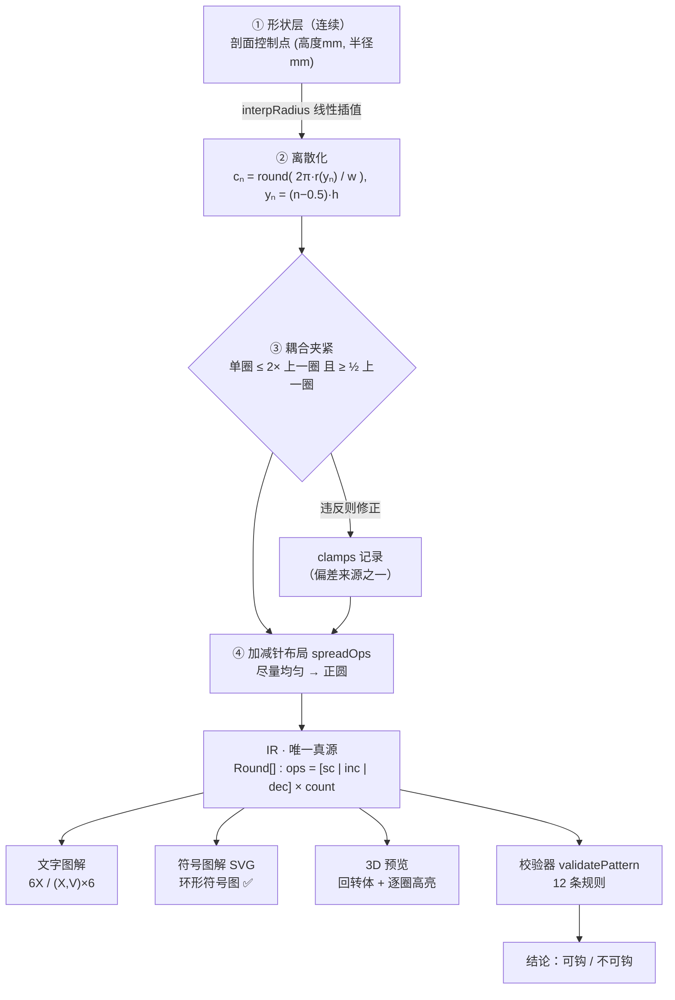
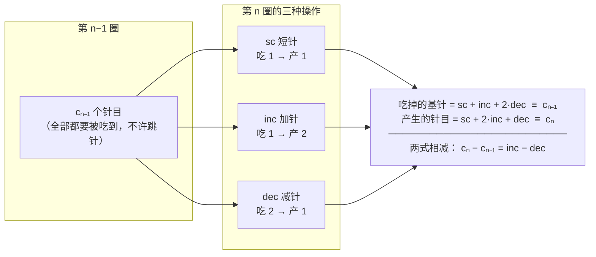
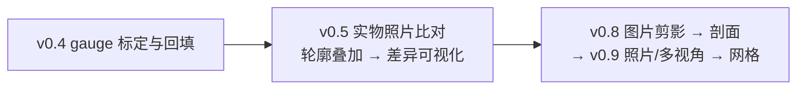

# 架构与数据流

## 一、总览：单一真源，三条渲染路径

**关键约束**：`T`、`S`、`V3` 三条路径**只读同一份 IR**，谁也不许自己算一遍针数。
因此「3D 显示的形状」与「文字图解」不可能不一致 —— 不一致就是代码 bug，不是参数差异。

---

## 二、核心逻辑：针数守恒（校验器为什么能判对错）

上面第一行就是校验规则 **V003**：
它是**唯一的硬闸门** —— 成立则相邻两圈「耦合」成立，图解必然可钩；不成立就是错图解，无论看起来多合理。

---

## 三、为什么"加针率就是曲率"

短针近似正方形（针宽 w ≈ 针高 h），所以一行的针数就是那一圈的周长（以针宽为单位）：

| 每圈加针量 | 几何结果 | 曲率 |
|---|---|---|
| 少于铺平所需 | 往上鼓 → 球、头、身 | 正高斯曲率 |
| 正好铺平所需（短针圆盘 = **每圈 +6**） | 平面 | 零 |
| 多于铺平所需 | 往外张 → 马鞍、荷叶边 | 负高斯曲率 |

于是「设计玩偶」= 设计一条**针数曲线** `c₁, c₂, …, c_N`：
头/身是"加到一个峰值再对称减少"的曲线，手/腿是"快速加、长直筒、快速收"的曲线。

---

## 四、模块职责

| 层 | 文件 | 职责 | 状态 |
|---|---|---|---|
| 数据模型 | [`src/ir.js`](../src/ir.js) | 定义 IR、针法语义、守恒式的两个求和函数 | ✅ |
| 生成 | [`src/build.js`](../src/build.js) | 剖面 → 针数序列；耦合夹紧；加减针均匀布局；**偏差量化** | ✅ |
| 校验 | [`src/validate.js`](../src/validate.js) | 12 条规则，V003 为硬闸门 | ✅ |
| 输出·文字 | [`src/pattern.js`](../src/pattern.js) | 最小周期检测 → `6X` / `(X,V)×6` | ✅ |
| 输出·符号 | [`src/chart.js`](../src/chart.js) | 环形符号图 SVG：每针按"它穿在哪一针上"定位，不做平均分角度 | ✅ |
| 输出·3D | [`web/app.js`](../web/app.js) | three.js 回转体 + 逐圈高亮 + 侧视对照 | ✅ |
| 输出·力导向 | [`src/graph.js`](../src/graph.js) · [`src/force.js`](../src/force.js) | 任意拓扑：节点 = 针目、边 = 耦合，四力迭代求解 | ✅ |
| 装配 | [`src/assembly.js`](../src/assembly.js) | 挂载树：主体 + ×N 挂件，挂件按宿主圈均分方位角 | ✅ |
| 参数 | `gauge {w, h}` | 线材/钩针/手劲带来的真实尺度，**必须可标定** | ⬜ v0.4 |

---

## 五、诚实边界（刻意暴露，不隐藏）

1. **整数化 + 夹紧一定修改序列** → 成品必然偏离目标轮廓。
   `deviation()` 量化每圈偏差，界面必须显示最大相对偏差与被修正的圈。
   *不显示偏差，就等于假装公式是精确的。*
2. **`w`、`h` 不是常数** —— 取决于线材、钩针号、手劲，动辄 ±15%。
   没标定 gauge 之前，预览只能看**比例**，不能看**毫米**。
3. **塞棉量与线的弹性**参与最终形状，不建模。
4. **几何禁区**：负平均曲率 + 正高斯曲率的"火山口"形状，靠钩织 + 塞棉实现不了（AmiGo 论文已证明），必须提前改形。
5. **单个部件仍是回转体**。跨部件的任意拓扑已由 [`src/assembly.js`](../src/assembly.js) 的挂载树
   + 力导向承担（章鱼腿这类结构可以表达）；但**接缝只以文字备注给出**，还没有逐针缝合图解。

---

## 六、下一步（按依赖顺序）

v0.6（提示词 → 形状参数）与 v0.7（分件与接缝的挂载树）已经完成，不在上面这条链上：
它们只依赖已有的 `src/shape.js` 与力导向管线，不需要等 gauge 标定。

v0.4 仍是关键一步：**钩完两圈量实物，把真实 `w/h` 填回来**，预览立刻校正 ——
这一步打通后，"预览和实物对不上"的问题就基本消失了。
